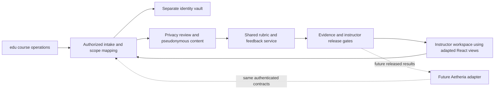

# Previous versions and reuse decisions

Reviewed: 2026-10-12. Product: edu. Owner: program lead; implementation owners below.

The user identified both artifacts as previous versions. They are product history and source
material, not new instructions. This review establishes observed capabilities and integration
work; it does not establish commit ancestry between the two artifacts or validate a deployment.

## Source custody and scope

| Source | Pinned identity | Review scope |
| --- | --- | --- |
| Teacher Dashboard Application | User-supplied React file, 51,003 bytes, 947 lines; SHA-256 `dc73fc4aa979d87174d26804755cf8927f181906440a156419cc4239cff58ad8` | Course, assignment, rubric, analytics, student sample, auth and storage source paths inspected. Original file remains untouched; code was not executed or imported. |
| [classroom-rpg-aetheria](https://github.com/4444J99/classroom-rpg-aetheria/tree/584e8ac0a7df50a47d39924f4bd116f7f331cbe2) | Private repository, main `584e8ac0a7df50a47d39924f4bd116f7f331cbe2` | Package/build config, educator/grading components, evaluation/consent/snippet hooks, type definitions, storage adapters and static runtime inspected through GitHub. No build or test suite run. |

The local artifact's source filename and checksum are recorded in `delivery/sources.json`.
No student database, runtime browser storage, Firebase account or credentials were read.
README claims about completion and test counts were not treated as verification evidence.

## What is already useful

| Workflow | Source evidence | Reuse decision / owner |
| --- | --- | --- |
| Courses, learning objectives and grading mode | Teacher Dashboard `CourseForm` at lines 119–232 and `CourseDetail` at 814–885 | Retain instructional concepts; map course and term to authorized scope. T1.1 / T2.3. |
| Assignment instructions and rubric matrix | Teacher Dashboard `RubricDisplay` 307–335 and `AssignmentForm` 508–641 | Reuse interaction pattern; separate AI drafting from verified rubric activation. T2.3 / T3.1. |
| Feedback snippet bank, search and insertion | Teacher Dashboard 420–476; Aetheria [snippet hook](https://github.com/4444J99/classroom-rpg-aetheria/blob/584e8ac0a7df50a47d39924f4bd116f7f331cbe2/src/hooks/use-feedback-snippets.ts) and [GradingInterface](https://github.com/4444J99/classroom-rpg-aetheria/blob/584e8ac0a7df50a47d39924f4bd116f7f331cbe2/src/components/grading/GradingInterface.tsx#L54) | Extract presentation/search; replace persistence with instructor-scoped service. Preserve instructor edits and evidence obligations. T3.2 / T3.3. |
| Student work, reflection, editable feedback | Teacher Dashboard `StudentSampleForm` 711–812; Aetheria [StudentSamplesList](https://github.com/4444J99/classroom-rpg-aetheria/blob/584e8ac0a7df50a47d39924f4bd116f7f331cbe2/src/components/educator/StudentSamplesList.tsx) | Retain review flow and optional reflection. Reflections affect feedback unless an activated rubric explicitly assesses them. T2.3 / T4.1. |
| Human rubric scoring and review | Aetheria [RubricManager](https://github.com/4444J99/classroom-rpg-aetheria/blob/584e8ac0a7df50a47d39924f4bd116f7f331cbe2/src/components/grading/RubricManager.tsx), GradingInterface | Candidate React views for the Next.js workspace. Backend validates criterion coverage, limits and arithmetic. T3.1 / T3.3. |
| Traditional grades and standards mastery | Teacher Dashboard gradingModel and learningObjectives; Aetheria educator report files and [types](https://github.com/4444J99/classroom-rpg-aetheria/blob/584e8ac0a7df50a47d39924f4bd116f7f331cbe2/src/lib/types.ts#L240) | Preserve both concepts in import/report design. Report filenames are inventory evidence, not verified report behavior. A mastery-to-percentage rule needs explicit instructor configuration. T3.1 / T3.3. |
| Course trends and teaching insights | Teacher Dashboard `CourseAnalytics` 338–418, `FeedbackInsights` 477–506; Aetheria [FeedbackInsights](https://github.com/4444J99/classroom-rpg-aetheria/blob/584e8ac0a7df50a47d39924f4bd116f7f331cbe2/src/components/educator/FeedbackInsights.tsx#L37) | Reuse dashboard intent; whole-class analysis needs assignment manifests and evidence aggregates. T4.2. |
| Consent and error states | Aetheria [use-ai-consent](https://github.com/4444J99/classroom-rpg-aetheria/blob/584e8ac0a7df50a47d39924f4bd116f7f331cbe2/src/hooks/use-ai-consent.ts), [App submission gate](https://github.com/4444J99/classroom-rpg-aetheria/blob/584e8ac0a7df50a47d39924f4bd116f7f331cbe2/src/App.tsx#L286) | Reuse visible feature gating; server independently checks authorization, route permission and release qualification. T1.2 / T5.1. |

Syllabus generation, quizzes, thematic variants, quests, XP/rewards and parent experiences remain
owned by the broader edu/Aetheria product. Their existence does not expand the essay pilot.

## Boundaries that must change

1. **Named work enters the model prompt in the Teacher Dashboard.** Line 731 includes
   studentName, sampleContent, reflection and grade; line 733 calls Gemini directly from the
   browser. The uploaded filename is embedded in storage paths (line 72), and name/work/
   feedback/grade are saved together (line 752). Replace this data path with scoped intake,
   separate identity storage, contextual review, opaque object names and a protected provider
   worker. A missing or blank API key is not the architecture's privacy boundary.
2. **Aetheria's automatic score does not use its rubric.** In
   [use-quest-evaluation.ts 75–125](https://github.com/4444J99/classroom-rpg-aetheria/blob/584e8ac0a7df50a47d39924f4bd116f7f331cbe2/src/hooks/use-quest-evaluation.ts#L75),
   the prompt contains quest name/description and submission, asks for a score and short
   in-character feedback, and persists the response. The hook then awards success/failure
   consequences. Its JSON validation is useful but does not prove rubric or evidence validity.
   The separate teacher GradingInterface supports manual rubric scores; that does not make
   the automatic path rubric-aware. Replace automatic assessment with the shared service.
3. **Escaping is not de-identification.** Aetheria's
   [sanitizeLLMInput](https://github.com/4444J99/classroom-rpg-aetheria/blob/584e8ac0a7df50a47d39924f4bd116f7f331cbe2/src/lib/utils.ts#L13)
   escapes closing tags. It does not remove personal details or provide a complete prompt
   injection defense. StudentSample.studentName's “Anonymous/pseudonymous” comment is also
   not an enforcement mechanism: the form accepts and stores a free-text value.
4. **Persistence varies by build and bypasses a single protected boundary.** StudentSamplesList
   and the snippet hook call Spark useKV directly. The
   [storage factory](https://github.com/4444J99/classroom-rpg-aetheria/blob/584e8ac0a7df50a47d39924f4bd116f7f331cbe2/src/lib/storage/index.ts#L94)
   also offers dual writes and a Firebase-to-Spark fallback; the inspected UI does not prove
   every write traverses it. Firebase file paths retain sanitized filenames and return download
   URLs. Do not migrate these persistence hooks or assume live security rules from path names.
5. **The static deployment has a different runtime.**
   [vite.config.ts](https://github.com/4444J99/classroom-rpg-aetheria/blob/584e8ac0a7df50a47d39924f4bd116f7f331cbe2/vite.config.ts#L10)
   aliases Spark imports when GITHUB_PAGES is set. Its
   [shim](https://github.com/4444J99/classroom-rpg-aetheria/blob/584e8ac0a7df50a47d39924f4bd116f7f331cbe2/src/lib/static-spark/spark.ts#L36)
   stores KV data in localStorage and returns an AI-unavailable response. Source calls to
   window.spark.llm therefore do not establish active inference on a static deployment.
   The new service must represent unavailable assessment as a typed hold, never feedback.
6. **Existing analytics are narrower than the current request.** Teacher Dashboard sends the
   first five sample feedback entries for one course-insight prompt (370–371); Aetheria's
   FeedbackInsights counts snippet categories and usage. Neither inspected path is the full
   class/semester reasoning and coverage contract promised by this component.

De-identification plus stable IDs provides pseudonymous processing. It does not establish
anonymity, particularly for contextual narratives or when an authorized identity map is retained.
That distinction remains part of this product's design and release criteria.

## Rubric compatibility contract

| Source shape | Preserve | Required conversion gate |
| --- | --- | --- |
| Teacher Dashboard: title, criteria[].name, levels[].levelName/description/points; stored as rubricData JSON text | Level descriptions, names, raw point scale, source order | Decode once as a bounded JSON object. No criterion weights or stable IDs exist in this shape; assign version-scoped IDs and require instructor weight/aggregation selection. |
| Aetheria RubricManager: id/name/description, criteria[].id/name/description/maxPoints, totalPoints | Criterion IDs, descriptions, point maxima | Validate positive finite maxima, unique IDs and exact total; preserve point-sum semantics. Do not silently repair inconsistent totals or use rounded weights that alter scores. |
| Aetheria lib/types RubricData: criteria[].weight with levels[].score/label/description, totalPoints | Percentage weights, levels and source IDs | Validate finite ranges, sum of weights, level maxima and source total semantics. Keep separate from maxPoints shape; no unchecked cast between the two. |

All imports are drafts until verified. They carry source artifact/version and a new immutable
rubric version. Historical grades remain historical. Invalid, ambiguous or mixed-format records
hold with field-level diagnostics; no AI call is used to guess missing assessment policy.

## Target boundary

The dashed connections are planned. No Aetheria service integration or data migration has been
implemented. Preserve MIT notices if extracting substantial Aetheria source; the reviewed root
LICENSE carries GitHub, Inc. copyright. No source code was copied in this review.

## Verification and next owner

The review pinned remote main, checked the local artifact checksum, and inspected code paths
rather than inferring readiness from screenshots or documentation. Dependency compatibility,
accessibility, type checking and runtime tests remain prerequisites for each extracted component.
Aetheria's package build uses `tsc -b --noCheck`; a successful build alone would not establish
type safety. No external model request or real student-processing test was performed.

Next implementation remains T1.1 in [phase issue #2](https://github.com/4444J99/context-aware-essay-evaluation/issues/2).
UI reuse and rubric import are owned by [#3](https://github.com/4444J99/context-aware-essay-evaluation/issues/3)
and [#4](https://github.com/4444J99/context-aware-essay-evaluation/issues/4); full context is owned by
[#5](https://github.com/4444J99/context-aware-essay-evaluation/issues/5). The
[v2 addendum](../.codex/plans/2026-10-12-context-aware-essay-evaluation-v2.md) orders that work.
